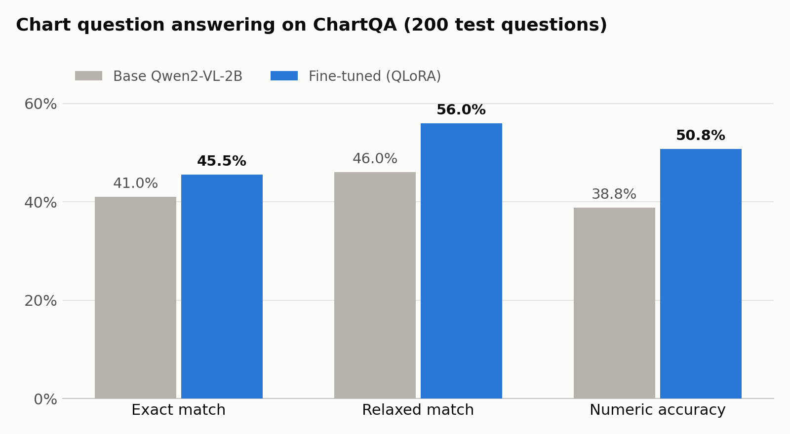
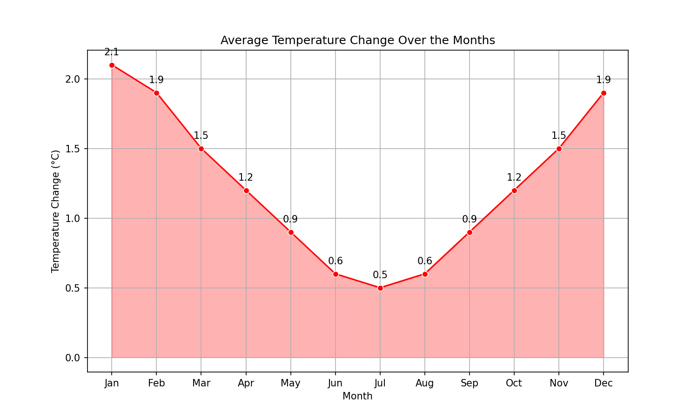
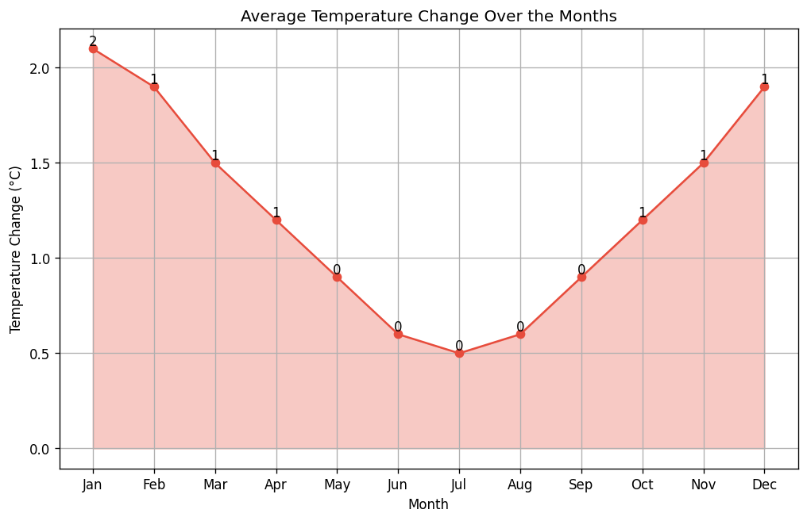

# Chart Generation & Visual Question Answering Pipeline

An end-to-end system that generates charts from text descriptions and answers questions about them using two fine-tuned models.

## 📋 Overview

This project demonstrates a complete pipeline combining:

1. **Chart Generation** – Converting natural language descriptions into executable chart code
2. **Visual Question Answering** – Answering questions about generated or existing charts

### Models Used

- **StarCoderBase-1B** (fine-tuned with LoRA) – Generates Python (matplotlib) chart code from text
- **Qwen2-VL-2B-Instruct** (fine-tuned with QLoRA) – Performs visual question answering on chart images

---

## 📊 Results

### Visual Question Answering (Stage 2)

Fine-tuning Qwen2-VL-2B on 2,000 ChartQA examples (2 epochs, QLoRA) improved accuracy on all three metrics, measured on the same 200 ChartQA test questions:



| Metric | Base model | Fine-tuned | Change |
|---|---|---|---|
| Exact match | 41.0% | 45.5% | +4.5 pp |
| Relaxed match | 46.0% | 56.0% | +10.0 pp |
| Numeric accuracy | 38.8% | 50.8% | +11.9 pp |

The fine-tuned model also learned the expected answer format (e.g. `3` instead of *"There are three bars"*).

### Chart Generation (Stage 1)

On 50 held-out ChartGen-200K descriptions, the fine-tuned StarCoderBase-1B produced **syntactically valid code in 98%** of cases, and **94% of the generated scripts executed** and rendered a chart.

### End-to-end example (Stage 3)

Text description → generated chart → question answered by the fine-tuned VQA model:

| Original chart (ChartGen) | Chart generated by the pipeline |
|---|---|
|  |  |

> **Q:** What is the temperature change in July?  **Model answer:** 0.5  ✅ (ground truth: 0.5)

On a small demo set of 10 descriptions, all 10 generated scripts executed successfully, and the VQA model answered 8/10 questions about the generated charts exactly right.

---

## 📂 Project Structure
```
├── Stage1_Chart_Generation.ipynb # Fine-tuning StarCoderBase-1B
├── Stage2_Visual_QA.ipynb # Fine-tuning Qwen2-VL-2B
├── Stage3_Full_Pipeline.ipynb # End-to-end demo
├── assets/ # Figures used in this README
├── README.md
```

---

## 🧩 Stage Summaries

### **Stage 1 — Chart Generation**
- Fine-tunes **StarCoderBase-1B** using LoRA + 8-bit quantization  
- Trained on a subset of **ChartGen-200K**  
- Outputs valid matplotlib code based on natural-language prompts  

### **Stage 2 — Visual Question Answering**
- Fine-tunes **Qwen2-VL-2B-Instruct** with QLoRA  
- Trained on a subset of **ChartQA**  
- Answers questions about charts

### **Stage 3 — Full Pipeline**
- Takes a text description  
- Generates chart code  
- Executes the code  
- Answers user questions about the produced chart  

---

## Authors
Developed in a team of two.

**My contributions:**
- Fine-tuned and evaluated the Visual Question Answering model (Stage 2)
- Contributed to the end-to-end pipeline integration (Stage 3)
